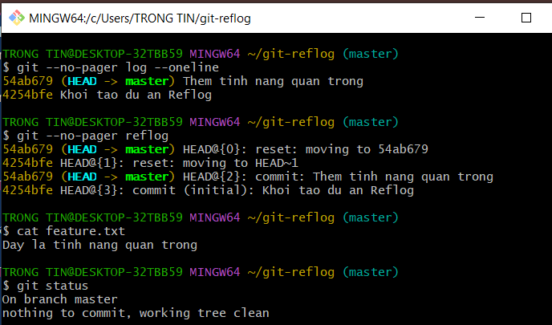

# Bài 1: Khôi phục commit đã mất bằng Git Reflog

## 1. Chuẩn bị
Tạo repository thử nghiệm git-reflog và cấu hình tên, email bằng --local.
Tạo commit nền "Khoi tao du an Reflog".

## 2. Tạo commit quan trọng

```bash
echo "Day la tinh nang quan trong" > feature.txt
git add feature.txt
git commit -m "Them tinh nang quan trong"
git log --oneline
```

Mã commit quan trọng: [điền mã thực tế].

## 3. Giả lập mất commit

```bash
git reset --hard HEAD~1
git log --oneline
```

Sau reset, commit quan trọng không còn trong lịch sử nhánh.
Tệp feature.txt không còn trong thư mục làm việc.

## 4. Tra cứu và khôi phục

```bash
git reflog
git reset --hard [mã commit tìm được]
```

Tìm dòng có thông điệp "Them tinh nang quan trong" trong Reflog,
sau đó dùng mã commit để đưa nhánh về trạng thái cũ.

## 5. Kết quả

```bash
git log --oneline
git reflog
cat feature.txt
git status
```

Dán kết quả thực tế tại đây.

## 6. Giải thích
Git log hiển thị lịch sử commit từ nhánh hiện tại.
Reflog ghi lại các lần thay đổi tham chiếu cục bộ, giúp tìm lại
commit không còn xuất hiện trong lịch sử nhánh sau reset.